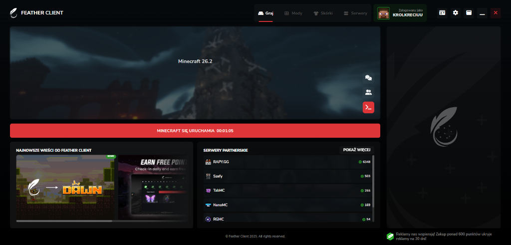
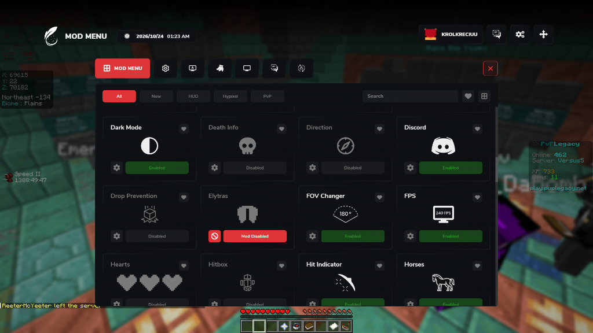
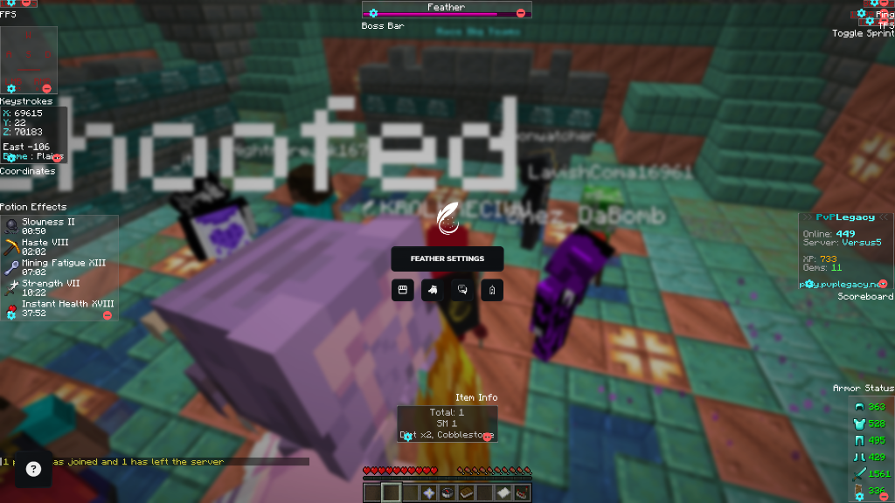

# Feather Client Fix (Dawn bypass and Error 522 fix)

inpvp bought feather client and started force updating everybody to dawn client, removed the launcher dns and the in-game webapp server died with cloudflare error 522.

this fixes microsoft login, blocks forced dawn update and patches the in-game menu so feather actually works on all versions (both forge and fabric).





## Where to get Feather Launcher
if you dont have feather client installed yet or deleted it, the original installer is still archived here:
https://featherclient.pl/strona-pobierania/

## How to use (quick way)
1. download this repo (or just grab `fix-feather.bat` and `feather-fix-522.jar` in the same folder).
2. right click `fix-feather.bat` and run as administrator.
3. launch feather client and play.

## How to do it manually (if u dont want to run .bat)
1. open notepad as admin and open `C:\Windows\System32\drivers\etc\hosts`
2. add these two lines at the end:
```
127.0.0.1 launcher.feathercdn.net
104.26.11.70 game-launcher.feathermc.com
```
3. save and run `ipconfig /flushdns` in cmd.
4. delete `%localappdata%\feather-updater` and `%localappdata%\Dawn` if they exist.
5. go to `C:\Program Files\Feather Launcher\resources\` and rename `app-update.yml` to `app-update.yml.bak`.
6. copy `feather-fix-522.jar` into `%appdata%\.feather\agent\`.
7. open `%appdata%\.feather\settings.json` and add this inside the json:
```json
"jwmArgs": "-javaagent:C:/Users/YOUR_USERNAME/AppData/Roaming/.feather/agent/feather-fix-522.jar"
```
(make sure to replace YOUR_USERNAME with your real windows username and use forward slashes).

## How it works in short
- **Dawn block:** pointing `launcher.feathercdn.net` to 127.0.0.1 stops the launcher from downloading the dawn update files. renaming `app-update.yml` disables electron auto updater.
- **Login / download fix:** the dns for `game-launcher.feathermc.com` got deleted by inpvp, but the old cloudflare server is still up at `104.26.11.70`. adding it to hosts fixes account login and version index downloads.
- **Error 522 menu fix:** feather loads the in-game menu from `https://mc-webapp.feathermc.com/` which is offline. but the beta server `https://beta.mc-webapp.feathermc.com/` is still online and working. `feather-fix-522.jar` is a tiny java agent that swaps the dead url to the beta url directly in memory when minecraft starts, so it works on any version (1.8.9, 1.12.2, 1.20, 1.21, etc.) without corrupting jar hashes. full java source is in `src/FeatherFix522.java`.
